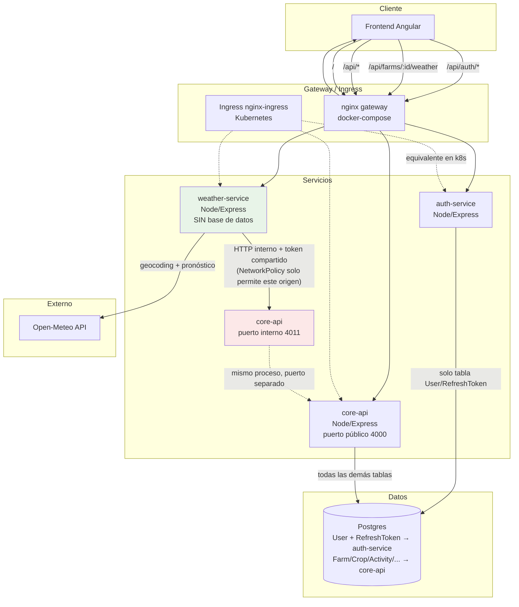

# Arquitectura — FincaApp

## Contexto

FincaApp empezó como un monolito Express (`backend/`) y se dividió en tres
servicios reales (`auth-service`, `weather-service`, `core-api`) más un
gateway. La pregunta que guió cada decisión de este documento fue siempre la
misma: **¿esto resuelve un problema real de este sistema, o es un buzzword
que se ve bien en un README?** Donde la respuesta fue "buzzword", no se
implementó (ver la sección "Qué NO se hizo, a propósito" al final).

## Diagrama

## Por qué estos tres servicios (y no más, ni menos)

Se evaluaron tres opciones (documentadas y decididas junto con el usuario
antes de implementar):

1. **Monolito dockerizado, listo para extraer** — cero riesgo, pero no
   demuestra separación de servicios real.
2. **Split completo por dominio** (8+ microservicios) — vistoso en un
   diagrama, pero para una app de este tamaño es sobre-ingeniería: cada
   consulta que hoy es un `Promise.all` de Prisma se volvería una cadena de
   llamadas HTTP con sagas/compensación, sin ningún beneficio funcional real.
3. **Extraer 2 servicios con límites de dominio genuinos** (la opción
   elegida) — `auth` y `weather` son los dos candidatos naturales:
   - `auth-service` es el ejemplo clásico de servicio transversal: **todo**
     lo demás depende de él para verificar identidad, pero él no depende de
     nada más.
   - `weather-service` es el candidato perfecto para demostrar
     statelessness real: no tiene tablas propias, no tiene estado, solo
     transforma un input (`farmId`) en una llamada a una API externa. Es el
     único de los tres que **no tiene Prisma instalado ni puede conectarse a
     la base de datos**, ni por código ni por red (`NetworkPolicy`).

`core-api` se queda con todo lo que comparte transacciones/consultas
relacionadas entre sí (fincas, cultivos, actividades, jornales, trabajadores,
transacciones, dashboard, analítica predictiva) — separarlos entre sí
significaría reconstruir con HTTP lo que hoy son joins de una sola
transacción de Prisma, sin ganar nada a cambio.

## El contrato entre weather-service y core-api

Este es el único punto de acoplamiento real entre dos servicios de negocio,
así que vale la pena explicarlo en detalle:

- `GET /internal/farms/:farmId/weather-context?userId=<id>` — `weather-service`
  ya validó el JWT y extrajo el `userId`; se lo pasa a `core-api` para que
  **vuelva a verificar ownership** del lado de quien sí tiene la tabla
  `Farm` (weather-service nunca asume que un farmId es válido u ownable solo
  porque el JWT es válido). Devuelve coordenadas, actividades y cultivos
  activos — todo lo que la regla de recomendaciones necesita.
- `PATCH /internal/farms/:farmId/geocode` — si `weather-service` geocodificó
  una ubicación (texto libre → lat/lng vía Open-Meteo), se lo reporta a
  `core-api` para que lo persista. `weather-service` nunca escribe en la base
  de datos directamente — ni siquiera podría, no tiene el cliente de Prisma.
- Ambos endpoints viven en un **listener HTTP separado** (`internalApp.js`,
  puerto 4011) del que sirve el tráfico público (`app.js`, puerto 4000) —
  así que aunque alguien mal configure el Ingress/gateway, hacerlo público
  requeriría un error en dos lugares distintos, no uno.

## Datos: una base física, propiedad lógica separada

`auth-service` y `core-api` comparten el mismo Postgres físico, pero:

- `core-api/prisma/schema.prisma` es la **única** fuente de verdad de
  migraciones (`prisma db push`) — declara todas las tablas, incluida
  `User`, por integridad referencial (`Farm.userId`), aunque nunca la
  consulta en runtime.
- `auth-service/prisma/schema.prisma` es un **subconjunto** (solo `User` +
  `RefreshToken`) que genera su propio cliente de Prisma mediante
  `prisma generate`, pero **nunca corre `db push`/`migrate`** — así se evita
  que dos servicios peleen por la misma migración.
- Ningún controller de ningún servicio hace un join cross-tablas que cruce
  esta frontera. Eso es lo que hace que, el día que se necesite, separar
  físicamente las dos bases sea un cambio de `DATABASE_URL`, no una
  reescritura.

## Verificado en un clúster real, no solo "en papel"

Durante el desarrollo se levantó un clúster local (`kind`) para desplegar
`k8s/base` + `k8s/overlays/production` de verdad, no solo validar el YAML.
Ese ejercicio encontró y corrigió dos bugs reales que `kustomize build` por
sí solo nunca habría detectado:

1. El puerto del frontend cambió de 80 a 8080 (nginx no-root no puede
   bindear puertos <1024 sin `NET_BIND_SERVICE`) pero la `NetworkPolicy`
   seguía autorizando solo el puerto 80 — el Ingress no podía conectarse
   (504 Gateway Timeout) hasta corregirlo.
2. El `Job` de migración no tenía el label `app: core-api` en su pod
   template, así que la misma `NetworkPolicy` que protege Postgres
   correctamente lo bloqueaba a él también.

Ambos son exactamente el tipo de bug que una política de red bien hecha
*debería* atrapar — la NetworkPolicy funcionaba correctamente, lo que estaba
mal configurado eran los manifiestos que dependían de ella. Se dejan
documentados aquí en vez de "limpiados silenciosamente" porque son la mejor
evidencia de que esto se probó de verdad.

## docker-compose vs. Kubernetes: por qué el gateway no se duplica en k8s

`services/gateway/nginx.conf` (un contenedor nginx haciendo reverse proxy)
existe **solo** para `docker-compose`/desarrollo local, donde no hay un
Ingress controller disponible. En Kubernetes, `k8s/base/ingress.yaml` hace
exactamente el mismo enrutamiento por path (mismo orden de precedencia
regex-antes-que-prefijo) pero a través de `ingress-nginx`, que es el patrón
idiomático del ecosistema — no tiene sentido correr un proxy nginx *dentro*
de otro proxy nginx.

## Qué NO se hizo, a propósito

- **Cola de mensajes (Kafka/RabbitMQ/NATS)**: no hay ningún flujo asíncrono
  real en esta app (no hay notificaciones diferidas, no hay workflows de
  larga duración). Agregar un event bus solo para que el diagrama tenga una
  cola habría sido ruido, no arquitectura.
- **Service mesh (Istio/Linkerd)**: con 3 servicios internos, el overhead
  operativo de un mesh no se justifica todavía. El token compartido +
  NetworkPolicy cubre el caso de uso actual; el mesh sería el paso lógico
  *siguiente* si el número de servicios creciera.
- **Terraform / IaC de infraestructura cloud**: no hay una cuenta de nube
  real detrás de este proyecto para provisionar, así que un Terraform que
  nadie puede aplicar ni verificar sería decorativo. Los manifiestos de k8s
  sí se probaron en un clúster real (ver arriba).
- **Helm**: Kustomize (base + overlay de producción) es suficiente para las
  necesidades actuales (variar réplicas/recursos/host por entorno) sin la
  complejidad de mantener un chart completo con `values.yaml` versionado.
